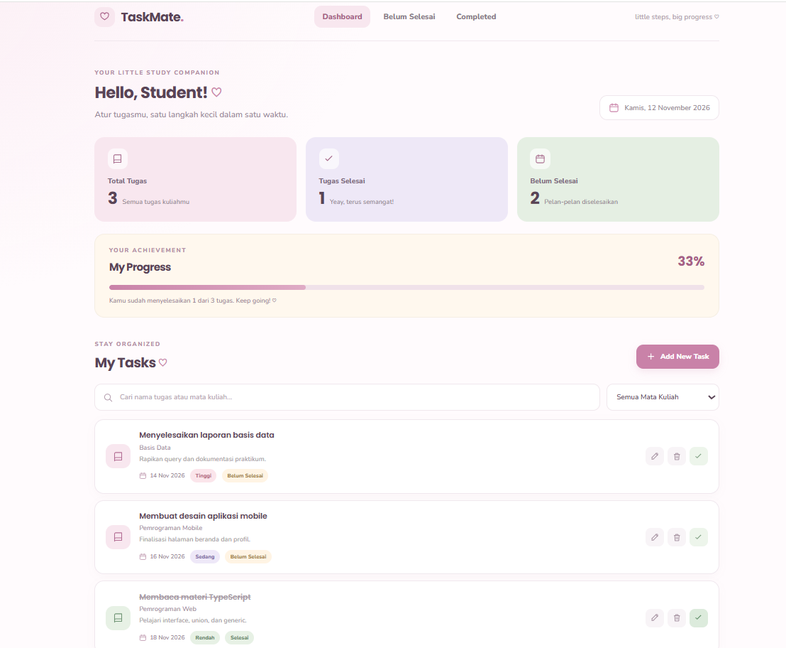

# TaskMate ♡ — My College Task Manager

TaskMate adalah aplikasi web sederhana untuk membantu mahasiswa mengatur tugas kuliah dengan tampilan cute pastel. Aplikasi dibuat menggunakan Vite dan TypeScript, serta menyimpan data secara lokal di browser menggunakan LocalStorage.

## Fitur
- Melihat ringkasan total, tugas selesai, dan tugas yang belum selesai.
- Menambahkan, mengedit, dan menghapus tugas.
- Menandai tugas selesai atau mengembalikannya ke status belum selesai.
- Menyimpan mata kuliah, deskripsi, deadline, dan prioritas.
- Mencari tugas dan memfilter berdasarkan mata kuliah maupun status.
- Progress penyelesaian tugas otomatis.
- Responsive untuk desktop dan HP.
- Data tetap tersimpan setelah halaman dimuat ulang melalui LocalStorage.

## Teknologi
- Vite — development server dan bundler.
- TypeScript — JavaScript dengan sistem tipe.
- HTML dan CSS — struktur dan tampilan.
- npm — manajemen package.
- LocalStorage — penyimpanan data di browser.

## Menjalankan project
Pastikan Node.js dan npm sudah terpasang.

```bash
npm install
npm run dev
```

Buka alamat lokal yang ditampilkan Vite di terminal.

## Build untuk deployment
```bash
npm run build
npm run preview
```

Hasil build berada di folder `dist/`. Untuk hosting statis seperti InfinityFree, unggah **isi folder `dist/`** ke folder tujuan website.

## Environment variables
Salin `.env.example` menjadi `.env` jika diperlukan. Variabel `VITE_APP_NAME` dan `VITE_APP_VERSION` hanya konfigurasi tampilan, bukan rahasia. Jangan menaruh password atau API secret pada variabel berawalan `VITE_` karena nilainya dapat ikut masuk ke bundle browser.

## Catatan penyimpanan
TaskMate menggunakan LocalStorage, sehingga data tersimpan di browser/perangkat yang digunakan. Data tidak otomatis tersinkron ke perangkat lain. Tombol hapus akan meminta konfirmasi sebelum menghapus tugas.

## Contoh TypeScript yang digunakan
- Primitive types: `string`, `number`, `boolean`.
- Array: `Task[]`.
- Interface: `Task`.
- Type alias: `Priority`, `TaskStatus`, dan `TaskFilter`.
- Union type: `'Tinggi' | 'Sedang' | 'Rendah'`.
- Generic: contoh fungsi generic dapat ditambahkan pada materi demonstrasi berikutnya.

## Pengembangan Selanjutnya

TaskMate dikembangkan untuk membantu mahasiswa mengelola tugas kuliah dengan lebih mudah.

Fitur utama:
- Mengelola tugas kuliah.
- Memantau deadline.
- Mengatur prioritas tugas.
- Melihat progres penyelesaian tugas.

## Screenshot
Tambahkan screenshot aplikasi pada folder `screenshots/`, lalu tampilkan di bagian ini, misalnya:

```md

```
